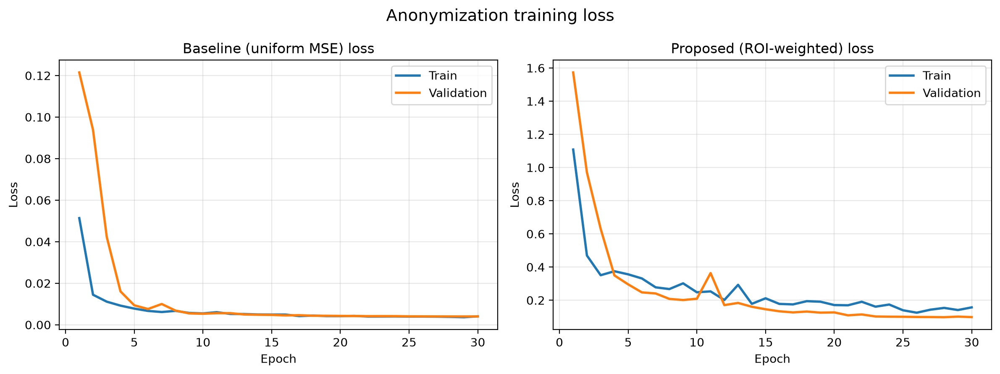
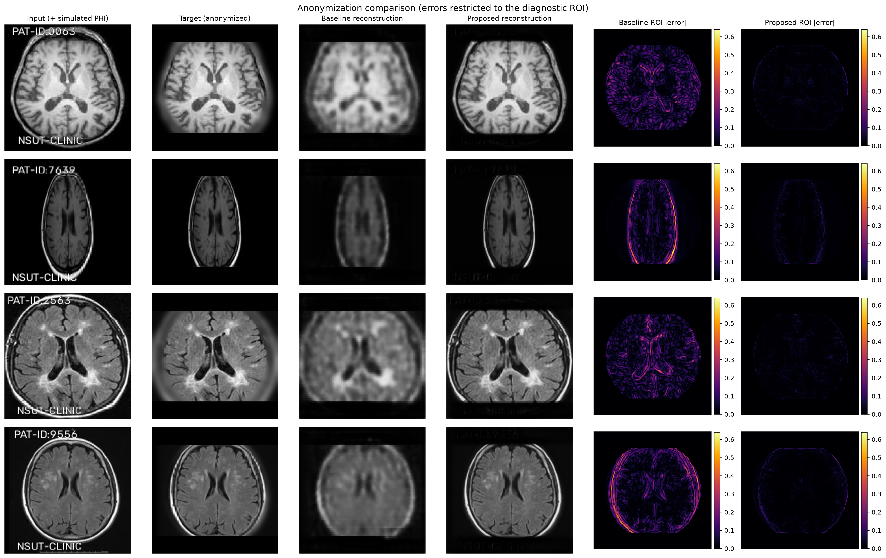
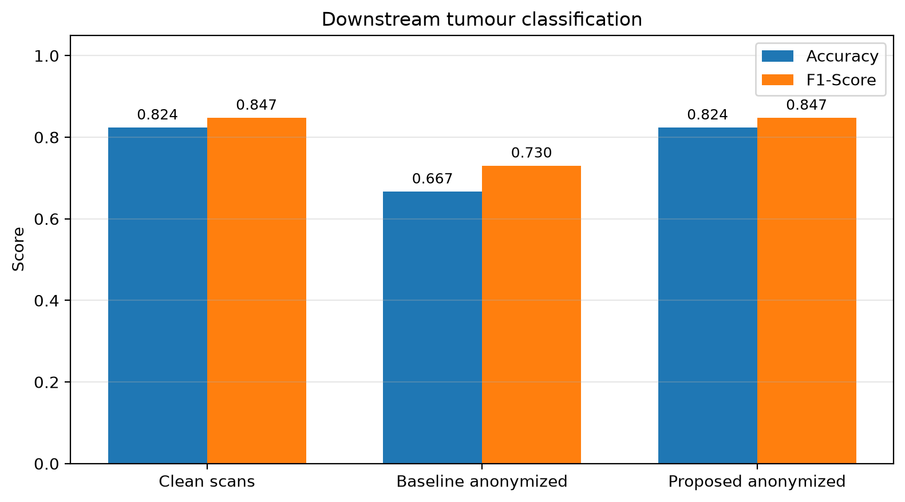

# Privacy-Preserving Medical Image Anonymization

This project studies how much *diagnostic* information survives medical-image
anonymization. A convolutional autoencoder takes a brain MRI that already
contains simulated burned-in DICOM PHI text and reconstructs an anonymized
version: the central **Region of Interest (ROI)** — where tumours live — is kept
sharp, while the outer skull/periphery is blurred and the PHI text bands are
erased. The central question is whether an ROI-weighted loss preserves tumour
signal that a standard autoencoder destroys.

Everything is self-contained and runs on a single machine; no real patient data
is used. PHI text is simulated deliberately.

## What it does

1. **Data** — downloads the public
   [`navoneel/brain-mri-images-for-brain-tumor-detection`](https://www.kaggle.com/datasets/navoneel/brain-mri-images-for-brain-tumor-detection)
   dataset via `kagglehub`, resizes to 128x128 grayscale, and builds an
   `(input, target)` anonymization pair per scan:
   - input: scan + simulated PHI (`PAT-ID:xxxx` top, `NSUT-CLINIC` bottom);
   - target: sharp elliptical central ROI, Gaussian-blurred periphery, PHI bands
     fully erased;
   - plus a binary ROI mask and the tumour label (`yes` = 1, `no` = 0).
2. **Anonymizers** — trains two autoencoders (`128 -> 16 -> 128`):
   - `BaselineAutoencoder`: plain 3-stage CAE, uniform MSE.
   - `ProposedSharpCAE`: same bottleneck plus encoder/decoder skip connections,
     trained with `SharpROILoss`.
3. **Evaluation** — test-set ROI PSNR / SSIM (and full-image PSNR / SSIM) for
   both anonymizers.
4. **Downstream utility** — trains `MedicalResNet18` on clean scans, then
   benchmarks tumour classification accuracy and F1 on clean, baseline-anonymized
   and proposed-anonymized inputs. This measures whether anonymization leaves the
   diagnosis intact.

## Architecture summary

| Component | Design |
| --- | --- |
| `BaselineAutoencoder` | 3 stride-2 conv stages (128→64→32→16) + transposed-conv decoder, Sigmoid output |
| `ProposedSharpCAE` | 3 encoder blocks returning skip tensors, 16-channel bottleneck, 3 U-Net-style decoder blocks that concatenate skips, Sigmoid output |
| `SharpROILoss` | `weight = 25*roi_mask + 2*(1-roi_mask)`, applied to `L2 + 0.5*L1` |
| `MedicalResNet18` | ImageNet ResNet-18, `conv1` rebuilt for 1 channel (RGB weights summed), 2-class head |
| `PrivacyMRIDataset` | 128x128 grayscale, deterministic per-image PHI jitter, elliptical ROI mask, blurred-periphery target |

The ROI weighting means a pixel inside the diagnostic ellipse costs 12.5x more
than a periphery pixel with the default weights (25 vs 2).

## Setup

Python 3.9+ is recommended. A GPU (CUDA or Apple MPS) is used automatically when
available and falls back to CPU otherwise.

```bash
python -m venv .venv
source .venv/bin/activate        # Windows: .venv\Scripts\activate
pip install -r requirements.txt
```

The dataset download needs Kaggle credentials. Either place a `kaggle.json` in
`~/.kaggle/` or set `KAGGLE_USERNAME` / `KAGGLE_KEY`; `kagglehub` picks these up.
If you already have the data locally, pass `--data-root <folder>` to skip the
download — the folder must contain `yes/` and `no/` subdirectories.

## Run

```bash
python train_and_eval.py
```

Useful flags:

```bash
python train_and_eval.py --data-root /path/to/dataset   # skip the download
python train_and_eval.py --epochs 50 --batch-size 32    # longer training
python train_and_eval.py --num-samples 200 --epochs 5   # quick smoke test
python train_and_eval.py --device cpu                   # force a device
python train_and_eval.py --help                         # all options
```

## Interactive demo

An interactive Streamlit app streams a single scan through both anonymizers and
the downstream classifier. It loads the saved checkpoints from `checkpoints/`
and reuses the same simulation and preprocessing code as training, so the live
metrics follow the benchmark methodology.

```bash
.venv/bin/streamlit run app.py
```

Train first so the checkpoints exist. In the sidebar you can pick a sample
tumour/normal scan or upload your own image, and edit the burned-in PHI text.
The main view shows the four-panel comparison, live ROI PSNR/SSIM, the live
`MedicalResNet18` tumour prediction per input, and an expander with the
30-epoch benchmark charts.

## Results

Verified with a full 30-epoch run on Apple MPS over a leakage-free split of the
253 unique scans (train / val / test = 171 / 31 / 51). The Kaggle archive ships
a duplicate `brain_tumor_dataset/` tree; `index_dataset()` reads only the
top-level `yes/` and `no/` folders, and `assert_no_split_leakage()` guarantees no
scan appears in more than one split.

### Anonymization quality (test set)

| Model | ROI PSNR | ROI SSIM | Full PSNR | Full SSIM |
| --- | ---: | ---: | ---: | ---: |
| `BaselineAutoencoder` (uniform MSE) | 22.41 dB | 0.6509 | 24.82 dB | 0.6759 |
| `ProposedSharpCAE` (ROI-weighted) | **35.24 dB** | **0.9345** | 24.04 dB | 0.7702 |

### Downstream tumour classification (test set)

`MedicalResNet18` trained on clean ROI crops, evaluated on three input conditions:

| Input | Accuracy | F1-Score |
| --- | ---: | ---: |
| Clean scans | 0.8235 | 0.8475 |
| Baseline anonymized | 0.6667 | 0.7302 |
| Proposed anonymized | **0.8235** | **0.8475** |

The ROI-weighted model preserves roughly 13 dB more ROI fidelity than the
baseline and keeps downstream accuracy at parity with clean scans, whereas
baseline anonymization loses about 16 accuracy points. The proposed model's
full-frame PSNR sits slightly below the baseline's by design — it deliberately
deprioritizes the blurred periphery, so the ROI metrics are the meaningful
comparison.

### Figures

Training loss for both anonymizers:



Side-by-side MRI reconstructions with ROI error heatmaps:



Downstream classification comparison across input conditions:



## Outputs

```
checkpoints/
  baseline_autoencoder.pt
  proposed_sharp_cae.pt
  medical_resnet18.pt
results/
  loss_curve.png                  # train/val loss for both anonymizers
  roi_error_heatmaps.png          # side-by-side MRI + ROI |error| heatmaps
  classification_comparison.png   # accuracy / F1 across input conditions
  metrics.json                    # PSNR, SSIM, accuracy, F1, split sizes
```

The console prints a summary table of ROI PSNR/SSIM and downstream
accuracy/F1 after training.

## Notes and caveats

- The dataset is small (~250 2D slices); results are indicative, not clinical.
- PHI and anonymization targets are synthetic simulations for coursework, not a
  validated de-identification pipeline.
- `MedicalResNet18` needs internet access to fetch ImageNet weights on first use;
  if the download fails it trains from scratch and prints a warning.
